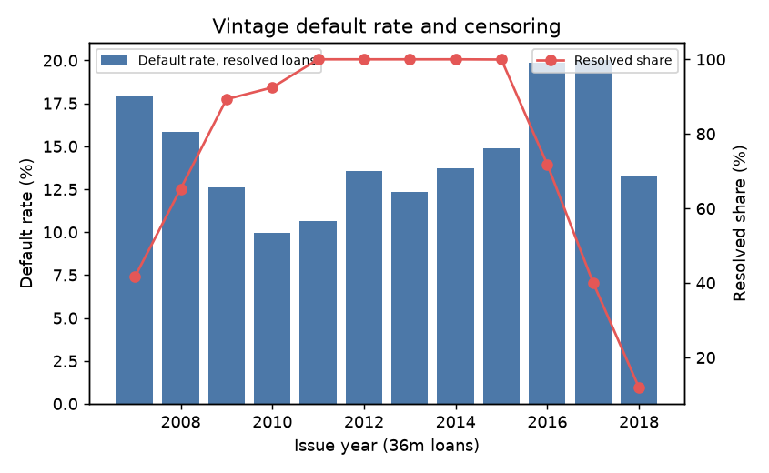
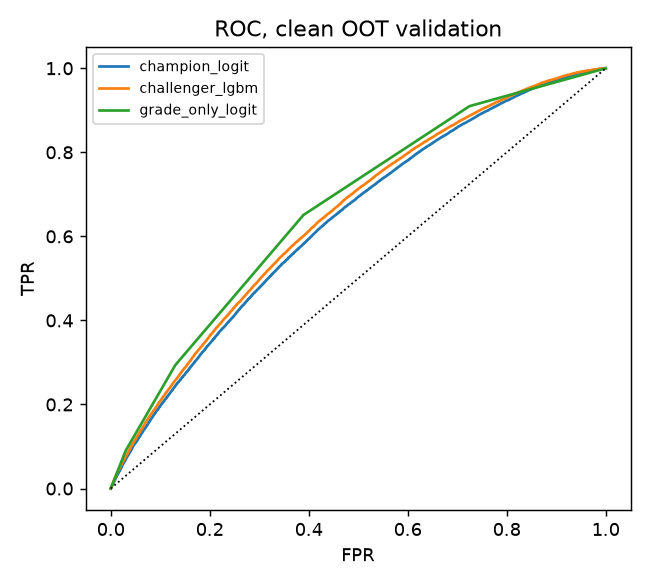
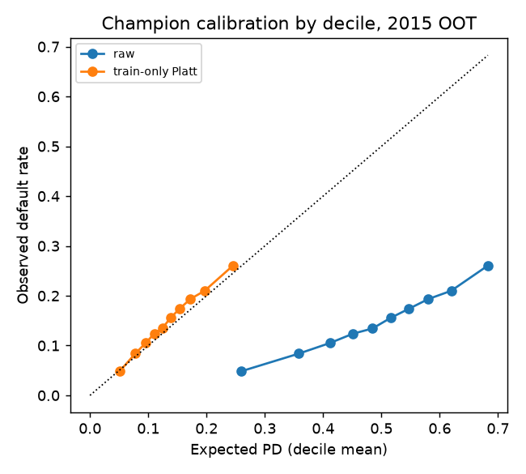
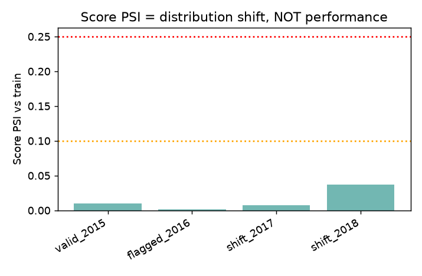
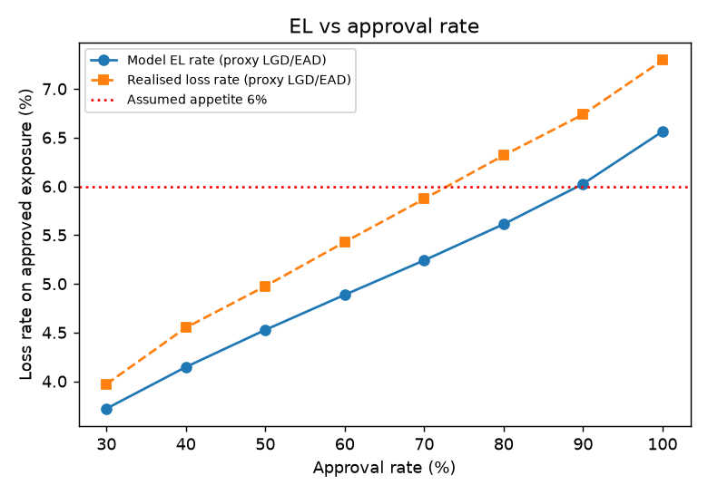

# Validation memo (independent-style review of the PD model)

_Generated 2026-11-19; every number below comes from the run that produced this file._

## 1. Scope and conclusions
PD model with out-of-time validation. LGD/EAD are proxies. Conclusions are about **this public dataset of accepted loans**, not a bank book.

## 2. Population, target and censoring
The snapshot is a single 2018Q4 cut, so late vintages are right-censored. We restrict to 36-month loans and treat only 2015 as fully matured. Vintage view:

| vintage_year | loans | resolved_share | default_rate_resolved | matured |
|---|---|---|---|---|
| 2007 | 603 | 0.4163 | 0.1793 | 1.0000 |
| 2008 | 2393 | 0.6527 | 0.1581 | 1.0000 |
| 2009 | 5281 | 0.8930 | 0.1260 | 1.0000 |
| 2010 | 9156 | 0.9246 | 0.0995 | 1.0000 |
| 2011 | 14101 | 1.0000 | 0.1063 | 1.0000 |
| 2012 | 43470 | 1.0000 | 0.1358 | 1.0000 |
| 2013 | 100422 | 1.0000 | 0.1233 | 1.0000 |
| 2014 | 162570 | 1.0000 | 0.1373 | 1.0000 |
| 2015 | 283173 | 0.9995 | 0.1489 | 1.0000 |
| 2016 | 323495 | 0.7183 | 0.1985 | 0.0000 |
| 2017 | 320419 | 0.4012 | 0.2002 | 0.0000 |
| 2018 | 344671 | 0.1197 | 0.1325 | 0.0000 |

**Clean-validation maturity audit (per issue month of the nominal clean year).** A month enters the clean sample only if fully matured and resolved share >= 95%.

| issue_month | loans | resolved_share | fully_matured | clean |
|---|---|---|---|---|
| 2015-01 | 23632 | 1.0000 | 1.0000 | True |
| 2015-02 | 16023 | 1.0000 | 1.0000 | True |
| 2015-03 | 16914 | 1.0000 | 1.0000 | True |
| 2015-04 | 23619 | 1.0000 | 1.0000 | True |
| 2015-05 | 21539 | 1.0000 | 1.0000 | True |
| 2015-06 | 19064 | 1.0000 | 1.0000 | True |
| 2015-07 | 30866 | 0.9999 | 1.0000 | True |
| 2015-08 | 23939 | 1.0000 | 1.0000 | True |
| 2015-09 | 18767 | 0.9999 | 1.0000 | True |
| 2015-10 | 33202 | 0.9995 | 1.0000 | True |
| 2015-11 | 25269 | 0.9989 | 1.0000 | True |
| 2015-12 | 30339 | 0.9968 | 1.0000 | True |

All issue months of the clean year passed the maturity/resolution audit.

**Load audit.** Raw rows parsed by DuckDB: 2,260,701 (assertion floor 2,200,000); model_frame rows (36m): 1,609,754. Full counts by status in `load_audit.json`.

## 3. Discrimination (calibrated PD)
| model | sample | n | default_rate | mean_pd | auc | gini | ks | brier |
|---|---|---|---|---|---|---|---|---|
| grade_only_logit | valid_clean | 283026 | 0.1489 | 0.1280 | 0.6675 | 0.3349 | 0.2616 | 0.1215 |
| grade_only_logit | flagged_censored | 232361 | 0.1985 | 0.1323 | 0.6656 | 0.3312 | 0.2559 | 0.1558 |
| champion_logit | valid_clean | 283026 | 0.1489 | 0.1364 | 0.6363 | 0.2725 | 0.1980 | 0.1232 |
| champion_logit | flagged_censored | 232361 | 0.1985 | 0.1321 | 0.6450 | 0.2899 | 0.2054 | 0.1576 |
| with_lc_logit | valid_clean | 283026 | 0.1489 | 0.1234 | 0.6834 | 0.3669 | 0.2670 | 0.1208 |
| with_lc_logit | flagged_censored | 232361 | 0.1985 | 0.1275 | 0.6874 | 0.3747 | 0.2718 | 0.1543 |
| challenger_lgbm | valid_clean | 283026 | 0.1489 | 0.1368 | 0.6492 | 0.2983 | 0.2155 | 0.1225 |
| challenger_lgbm | flagged_censored | 232361 | 0.1985 | 0.1345 | 0.6578 | 0.3156 | 0.2264 | 0.1560 |
| with_lc_lgbm | valid_clean | 283026 | 0.1489 | 0.1239 | 0.6871 | 0.3741 | 0.2725 | 0.1204 |
| with_lc_lgbm | flagged_censored | 232361 | 0.1985 | 0.1283 | 0.6929 | 0.3859 | 0.2787 | 0.1533 |

Sensitivity, champion trained on 2012-14 only: AUC 0.6364, Gini 0.2728, KS 0.1968, Brier 0.1232 (2015).

## 4. Calibration, 2015 champion
| variant | mean_pred | observed | cal_ratio | brier |
|---|---|---|---|---|
| raw (class-weighted) | 0.4911 | 0.1489 | 0.3031 | 0.2441 |
| train-only Platt | 0.1364 | 0.1489 | 1.0910 | 0.1232 |
| ORACLE intercept shift (diagnostic) | 0.1489 | 0.1489 | 1.0000 | 0.1230 |

Decile table (train-only Platt):

| decile | n | defaults | expected_pd | observed_dr | abs_gap | rel_gap | binom_p |
|---|---|---|---|---|---|---|---|
| 1 | 28303 | 1367.0000 | 0.0507 | 0.0483 | -0.0025 | -0.0483 | 0.0616 |
| 2 | 28303 | 2369.0000 | 0.0777 | 0.0837 | 0.0060 | 0.0773 | 0.0002 |
| 3 | 28302 | 2981.0000 | 0.0956 | 0.1053 | 0.0097 | 0.1014 | 0.0000 |
| 4 | 28303 | 3506.0000 | 0.1102 | 0.1239 | 0.0136 | 0.1237 | 0.0000 |
| 5 | 28302 | 3800.0000 | 0.1240 | 0.1343 | 0.0102 | 0.0826 | 0.0000 |
| 6 | 28303 | 4403.0000 | 0.1381 | 0.1556 | 0.0174 | 0.1261 | 0.0000 |
| 7 | 28302 | 4920.0000 | 0.1537 | 0.1738 | 0.0201 | 0.1307 | 0.0000 |
| 8 | 28303 | 5473.0000 | 0.1722 | 0.1934 | 0.0212 | 0.1231 | 0.0000 |
| 9 | 28302 | 5940.0000 | 0.1967 | 0.2099 | 0.0132 | 0.0672 | 0.0000 |
| 10 | 28303 | 7373.0000 | 0.2454 | 0.2605 | 0.0151 | 0.0617 | 0.0000 |

The ORACLE row uses validation outcomes and is a diagnostic: the gap between it and the deployable row is the part of miscalibration due to base-rate shift.

## 5. SMOTE vs class weights
| variant | valid_auc | valid_brier | mean_pred_pd | observed_dr | over_prediction_ratio |
|---|---|---|---|---|---|
| no_weights | 0.6364 | 0.1232 | 0.1363 | 0.1489 | 0.9154 |
| class_weight_balanced | 0.6363 | 0.2441 | 0.4911 | 0.1489 | 3.2993 |
| smote | 0.6363 | 0.2438 | 0.4907 | 0.1489 | 3.2965 |

Both rebalancing methods shift the *level* of predicted PD upwards (see `over_prediction_ratio`: mean predicted PD / observed default rate), because the model is trained as if defaults were ~50% of the book. Provision = PD x LGD x EAD is linear in PD, so an unrecalibrated level bias goes straight into the provision. For class weights this is a pure logit-intercept shift and the train-only Platt step removes it. SMOTE has the same level problem, and in addition fabricates synthetic defaults by interpolating in WoE space, which can distort the slope/shape of the score-to-PD relation and not just its level; the ranking benefit (AUC column) should therefore be judged against the no-weights model, not assumed. Decision: class weights + train-only recalibration; SMOTE kept as a documented negative-result test.

## 6. Distribution shift (PSI): NOT a performance metric
PSI compares score/feature distributions between train and another sample using no outcomes. A low PSI does not imply good performance and a high PSI does not imply poor performance.

| sample | score_psi |
|---|---|
| valid_2015 | 0.0100 |
| flagged_2016 | 0.0013 |
| shift_2017 | 0.0075 |
| shift_2018 | 0.0372 |

Feature PSI vs train:

| feature | flagged_2016 | shift_2017 | shift_2018 | valid_2015 |
|---|---|---|---|---|
| annual_inc | 0.0160 | 0.0140 | 0.0205 | 0.0050 |
| delinq_2yrs | 0.0038 | 0.0016 | 0.0030 | 0.0036 |
| dti | 0.0416 | 0.0334 | 0.0507 | 0.0418 |
| emp_length | 0.0172 | 0.0306 | 0.0433 | 0.0098 |
| fico_mid | 0.0048 | 0.0164 | 0.0772 | 0.0108 |
| home_ownership | 0.0123 | 0.0127 | 0.0152 | 0.0047 |
| loan_amnt | 0.0227 | 0.0460 | 0.0641 | 0.0099 |
| loan_to_income | 0.0089 | 0.0398 | 0.0406 | 0.0018 |
| purpose | 0.0383 | 0.0594 | 0.0602 | 0.0307 |
| revol_util | 0.0675 | 0.1211 | 0.2403 | 0.0165 |

## 7. Expected-loss decision layer (illustrative)
LGD 0.873 and CCF 0.577 are proxies from train defaults (recoveries and balance at default; not discounted; no downturn).

| approval_rate | pd_cutoff | approved_n | approved_default_rate | approved_mean_pd | el_rate_model | loss_rate_realised_proxy | defaults_rejected_share | good_loans_rejected_share | within_appetite |
|---|---|---|---|---|---|---|---|---|---|
| 0.3000 | 0.1032 | 84908 | 0.0791 | 0.0747 | 0.0372 | 0.0397 | 0.8406 | 0.6754 | True |
| 0.4000 | 0.1172 | 113210 | 0.0903 | 0.0836 | 0.0415 | 0.0455 | 0.7574 | 0.5725 | True |
| 0.5000 | 0.1309 | 141513 | 0.0991 | 0.0917 | 0.0453 | 0.0498 | 0.6672 | 0.4708 | True |
| 0.6000 | 0.1456 | 169816 | 0.1085 | 0.0994 | 0.0489 | 0.0543 | 0.5627 | 0.3715 | True |
| 0.7000 | 0.1624 | 198118 | 0.1178 | 0.1072 | 0.0524 | 0.0587 | 0.4459 | 0.2745 | True |
| 0.8000 | 0.1829 | 226421 | 0.1273 | 0.1153 | 0.0561 | 0.0632 | 0.3160 | 0.1797 | True |
| 0.9000 | 0.2131 | 254723 | 0.1365 | 0.1243 | 0.0603 | 0.0674 | 0.1750 | 0.0869 | False |
| 1.0000 | 0.3409 | 283026 | 0.1489 | 0.1364 | 0.0656 | 0.0729 | 0.0000 | 0.0000 | False |

## 8. Limitations
- Accepted loans only: no reject inference, so the model describes approved applicants, not the through-the-door population.
- `ignore_errors=true` can drop malformed CSV rows silently; mitigated by a row-count floor and `load_audit.json`, but the loss cannot be proven zero.
- Single snapshot, not a performance panel; no behavioural or macro covariates; the 2015 clean window is one vintage (macro regime of one year).
- LC grade/int_rate encode LC's own model (circular), so excluded from the champion; "with_lc" rows show incremental lift only.
- LGD/EAD are proxies; EL appetite is an assumed input; no Basel/IRB (no downturn LGD, margin of conservatism, or PD floors).
- Platt/class-weight recalibration restores the training base rate; it cannot anticipate a changed base rate. Monitor the observed/expected ratio.
- Recoveries in the snapshot are undiscounted.
